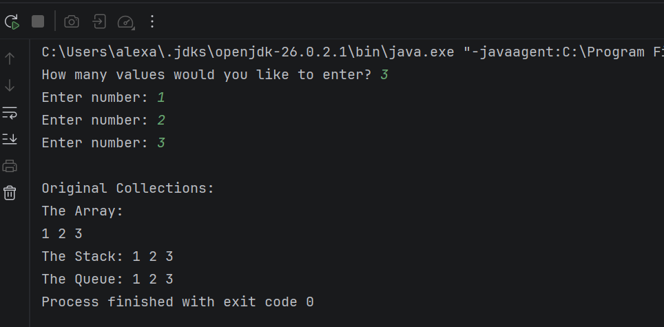
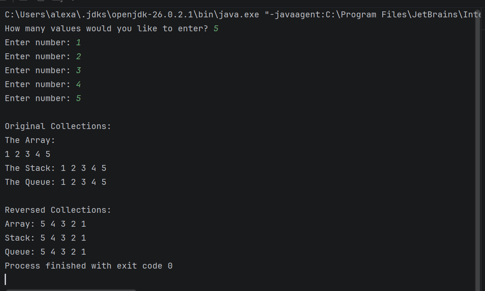

# Reversing Arrays, Stacks, and Queues

## Project Description
This program is written for a Java course and demonstrates working reversing collections, including arrays, stacks, and queues.

## How to Run
1. Open the project in IntelliJ.
2. Run `Main.java`.
3. Follow the prompts in the console to choose length of collection.
4. Enter valid positive numbers for each item in the collection.
5. Now you can view the original collection, stack and queue in output, followed by reverse collections.

## Screenshots

### Example of Original Collection ONLY

### All Collections and their Reversed Output
